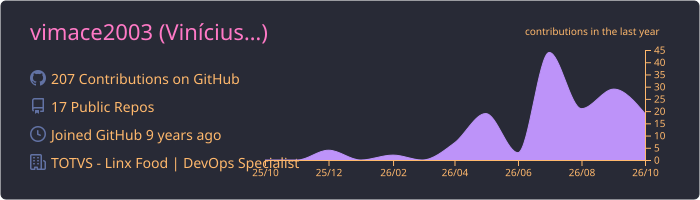
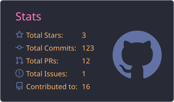
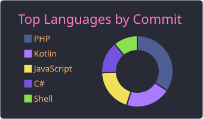

<h1 align="center">Hi, I'm Vinícius Macedo 👋</h1>

  <b>DevOps Specialist</b> at <b>TOTVS · Linx Food</b> &nbsp;|&nbsp; Florianópolis, Brazil 🇧🇷

  
  
  

## About me

- 🛠️ DevOps Specialist at **TOTVS (Linx Food)**.
- ⚙️ I like automating the whole path from commit to production: CI/CD pipelines, container images, infrastructure as code and the Linux servers underneath.
- ☁️ Hands-on with **Azure** and **AWS**: the projects below include pipelines that deploy to Azure App Service and Terraform for AWS ECS/Fargate.
- 📡 Licensed amateur radio operator (**PP5KJ**), so many of my side projects mix software, radio and hardware.
- 📫 Best way to reach me: **vimace2003@gmail.com**

## Tech stack

| | |
| --- | --- |
| **Cloud & IaC** |    |
| **Containers & CI/CD** |     |
| **Linux & web servers** |      |
| **Languages** |      |
| **Databases** |   |
| **Hardware & IoT** |    |
| **Tools** |   |

## Featured projects

<table>
  <tr>
    <td width="50%" valign="top">

### [Simple-PHP-Website-CI-CD](https://github.com/vimace2003/Simple-PHP-Website-CI-CD)

CI pipeline that bumps a semantic version tag, builds the Docker image, scans it with **Trivy** and publishes it to Docker Hub. Ships with **Terraform** for AWS ECS/Fargate (VPC, subnets, IAM, ECS service) and an observability plan.

`GitHub Actions` `Docker` `Trivy` `Terraform` `AWS ECS/Fargate`

</td>
    <td width="50%" valign="top">

### [DrapoWX](https://github.com/vimace2003/DrapoWX)

Real-time weather dashboard built with ASP.NET Core 8 and SignalR. Every push to `main` builds a Docker image, pushes it to Docker Hub and deploys it to **Azure App Service**; the Azure resources are provisioned with an Azure CLI script.

`.NET 8` `SignalR` `Docker` `GitHub Actions` `Azure`

</td>
  </tr>
  <tr>
    <td width="50%" valign="top">

### [LABRE-Pay](https://github.com/vimace2003/LABRE-Pay)

Membership billing system for LABRE-SC: bulk billing by email, MercadoPago payments (Pix, boleto, card) with webhooks plus daily reconciliation, and LGPD audit logs. CI lints the code, runs end-to-end tests in Docker Compose and deploys over FTPS.

`PHP` `MySQL` `Docker Compose` `GitHub Actions`

</td>
    <td width="50%" valign="top">

### [Radio-Cafe-PDV](https://github.com/vimace2003/Radio-Cafe-PDV)

Ultra-light point-of-sale proof of concept: a React (Vite) front end on Nginx talking to a **COBOL** CGI back end on Lighttpd, orchestrated with Docker Compose and published as container images by CI.

`COBOL` `React` `Nginx` `Docker Compose`

</td>
  </tr>
  <tr>
    <td width="50%" valign="top">

### [CalculadoraCLT-App](https://github.com/vimace2003/CalculadoraCLT-App)

Android app with Brazilian labor-law calculators (severance, net salary, vacation, overtime, FGTS and more). Modular Kotlin + Jetpack Compose, with a pure-Kotlin, unit-tested domain module and CI/release pipelines.

`Kotlin` `Jetpack Compose` `GitHub Actions`

</td>
    <td width="50%" valign="top">

### [SimpleAPRS](https://github.com/vimace2003/SimpleAPRS)

Firmware for an ESP8266 weather station: sends weather packets to APRS-IS, serves a responsive web dashboard, tracks INMET weather alerts and updates itself over the air (OTA).

`C++` `PlatformIO` `ESP8266`

</td>
  </tr>
</table>

## 🤝 Community

- ☁️ Part of the Florianópolis chapter of [**Azure User Groups Brasil**](https://azureusergroupsbrasil.com.br/)
- 🎤 Part of [**MVP Conf Regional Florianópolis**](https://mvpconf.com.br/regional/florianopolis/unisenai) at UniSENAI
- 🐧 Contributor to [**Debian Hams**](https://wiki.debian.org/DebianHams), the Debian team that packages amateur radio software
- 📣 Advocate for [**Floci**](https://floci.io/), an open-source local emulator for AWS, Azure, GCP and OCI that lets you build and test without cloud credentials or bills

## 📡 Off the clock

I'm a licensed amateur radio operator, callsign **PP5KJ** ([pp5kj.com](https://pp5kj.com)). I also build things for the ham radio community, like [automated VHF weather bulletins](https://github.com/vimace2003/Previsao-do-tempo-VHF-Linux) voiced by Azure AI Speech and the [Portuguese translation of the N1MM Logger+ manual](https://github.com/vimace2003/N1MM-PTBR) for [GG52 Floripa DX](https://gg52floripadx.com/).

## GitHub stats

  

  
  

